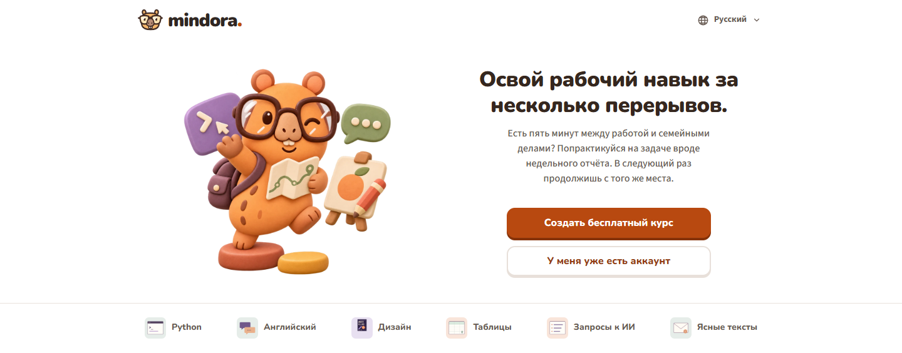
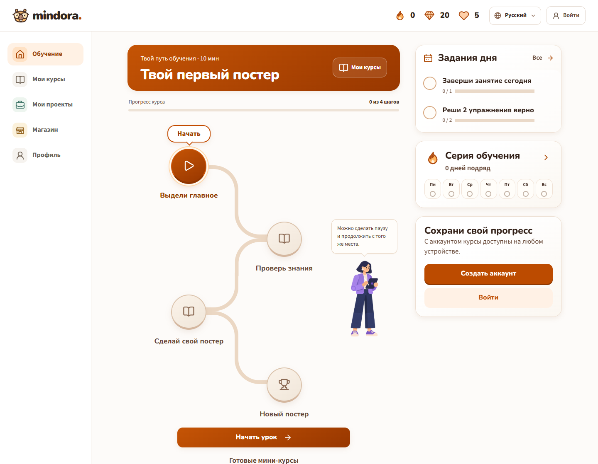
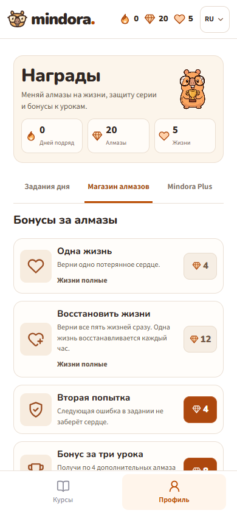
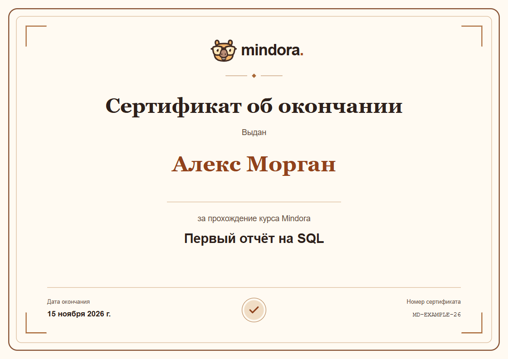

<p align="center">
  
</p>

# Mindora

Mindora помогает взрослым, которые совмещают работу, семью и учёбу, осваивать практические навыки короткими занятиями. Выбери готовый курс или опиши свою цель. Выдели **5, 10 или 20 минут на занятие**, выполни упражнение и постепенно собери результат, которым сможешь пользоваться.

Проект создан для трека **Skills** Business Cup 2.0. Основная аудитория — работающие взрослые 25–45 лет в США.

[Открыть Mindora](https://mindora-livid-eta.vercel.app/welcome) · [Попробовать практику без входа](https://mindora-livid-eta.vercel.app/#weekly-report) · [Локальный запуск](#локальный-запуск)



## Быстрый старт

### Без регистрации

1. Открой [«Еженедельный отчёт о расходах»](https://mindora-livid-eta.vercel.app/#weekly-report). Форма упражнения открывается сразу.
2. Посчитай расходы формулой, укажи вывод по бюджету и нажми **«Проверить отчёт»**. Затем выбери **«Открыть неделю 2»** и примени тот же навык на других данных.
3. После обоих заданий открой **«Сертификат курса»**. Введи имя для сертификата и скачай SVG.

Чтобы выбрать другую тему, открой [главную страницу](https://mindora-livid-eta.vercel.app/welcome), нажми «Создать бесплатный курс» и выбери **«Продолжить без аккаунта»**. Готовые мини-курсы доступны в разделе **«Мои курсы»**.

### Общий тестовый аккаунт

На [главной странице](https://mindora-livid-eta.vercel.app/welcome) нажми **«У меня уже есть аккаунт»**. Используй данные из таблицы.

| Поле | Данные |
| --- | --- |
| Почта | `mindora-browser-1794689182140@example.com` |
| Пароль | `Mino-QA-33b8311e-c218-4d6a-ad3e-23a93637e23a` |

Это общий демонстрационный аккаунт, поэтому в нём могут быть курсы и результаты других участников. Для личного прогресса используй свой аккаунт или гостевой режим.

## Как устроено обучение

1. **Цель и уровень.** В разделе «Мои курсы» выбери готовый мини-курс или нажми **«Создать курс»**. Если цель широкая, Mindora предложит уточнить, чему именно ты хочешь научиться и какой опыт уже есть.
2. **Карта курса.** Для персональной цели Mindora составляет маршрут из занятий, практик, повторений и мини-проектов. Сначала можно посмотреть весь путь. Конкретное занятие готовится при открытии его этапа.
3. **Практика в браузере.** Занятие включает объяснение, пример и задание. В SQL можно написать запрос и увидеть строки результата, в курсе по таблицам — проверить формулу, а в дизайне — собрать собственный постер. Для заданий с разбором ИИ Mindora предлагает конкретный следующий шаг.
4. **Возврат к занятиям.** Маршрут и задания можно снова открыть из **«Моих курсов»**. Гостевой прогресс хранится в браузере. С аккаунтом курсы и поддерживаемый прогресс синхронизируются между устройствами.
5. **Результат.** Готовые работы доступны в **«Моих проектах»**. После полного курса появляется именной **сертификат Mindora** в SVG. Сертификат можно повторно открыть из сохранённого курса.



## Что можно попробовать

| Раздел | Что в нём делать |
| --- | --- |
| **Мои курсы** | Открыть персональный путь или готовый мини-курс. Есть SQL, Python, английский, дизайн, рабочие таблицы и другие темы. |
| **Практика** | Сделать первый постер или таблицу расходов, собрать недельный отчёт, попробовать код, рисование или график. |
| **Мои проекты** | Открыть выполненные работы. Например, постер можно скачать в SVG, таблицу расходов — в CSV. |
| **Профиль и достижения** | Настроить темп, открыть учебную активность или черновик таблицы и посмотреть прогресс к достижениям. |
| **Награды** | Выполнить задания дня, получить алмазы и обменять их на бонусы, в том числе жизни и заморозку серии. |
| **Mindora Plus** | Пройти демо-покупку с итогом **$0**, сменить тариф и увидеть его в профиле. Бейдж **Plus · Демо** остаётся в том же браузере после перезагрузки. |

Интерфейс доступен на **русском, английском и казахском**. У персонального курса можно отдельно выбрать язык обучения. Mindora работает в браузере на компьютере и телефоне.

<p>
  
  
</p>

## Как Mindora готовит персональный курс

Сервер использует DeepSeek для уточнения цели, составления карты и разбора ответов. При подготовке занятий Mindora ищет открытые учебные материалы и примеры из GitHub, затем составляет объяснение и отдельные практические задания. Если у источника есть подходящая иллюстрация, она отображается в уроке с указанием источника. Детали поиска и обработки материалов описаны в [документации учебных инструментов](docs/COURSE-TOOLS.md).

В текущей демо-сборке доступен **один персональный путь на аккаунт или гостевой браузер**. Готовые мини-курсы доступны отдельно.

## Локальный запуск

Понадобится **Node.js 22** и npm.

```sh
git clone https://github.com/Asizxs33/Mindora.git
cd Mindora
npm ci
npm start
```

Открой [локальную Mindora](http://127.0.0.1:4173/welcome). Встроенные занятия и гостевая практика доступны локально сразу. Для входа, синхронизации и генерации добавь нужные серверные переменные окружения.

| Переменная | Назначение |
| --- | --- |
| `DATABASE_URL` | Подключение к Neon Postgres для хранения аккаунтов и учебного прогресса. |
| `NEON_AUTH_BASE_URL` | Адрес Neon Auth. |
| `NEON_AUTH_COOKIE_SECRET` | Секрет сессии Neon Auth длиной от 32 символов. |
| `DEEPSEEK_API_KEY` | Серверный ключ для персональных курсов и разбора заданий. |

Для публикации на Vercel выбери preset **Other**, задай переменные в окружении проекта и используй производственную ветку `main`. Команда сборки и каталог `dist` заданы в [vercel.json](vercel.json). Ключи сервисов хранятся в настройках окружения.

## Структура репозитория

| Путь | Что внутри |
| --- | --- |
| [ui/](ui/) | Экраны, адаптивные стили, Мино, иллюстрации курсов и [лицензия иконок Lucide](ui/assets/LUCIDE-LICENSE.txt). |
| [core/](core/) | Навигация, учебные сценарии, проверка ответов, прогресс и экспорт файлов. |
| [api/](api/) и [backend/](backend/) | Вход через Neon Auth, сохранение в Neon Postgres, генерация курсов и обратная связь. |
| [tests/](tests/) и [scripts/](scripts/) | Модульные проверки, браузерные сценарии и сборка. |

### Проверки

```sh
npm run check
npm test
node scripts/build.mjs
```

Для [браузерного сценария](scripts/verify-public-browser.mjs) нужны Playwright и Chrome. Запусти сайт, укажи его адрес в `MINDORA_URL` и выполни `node scripts/verify-public-browser.mjs`. Если Playwright установлен отдельно, укажи путь к пакету в `PLAYWRIGHT_MODULE`.

Для работы в команде смотри [руководство по веткам и контракту UI](docs/TEAM.md) и [шаблон задачи для Codex-дизайнера](docs/CODEX-DESIGN-PROMPT.md).
