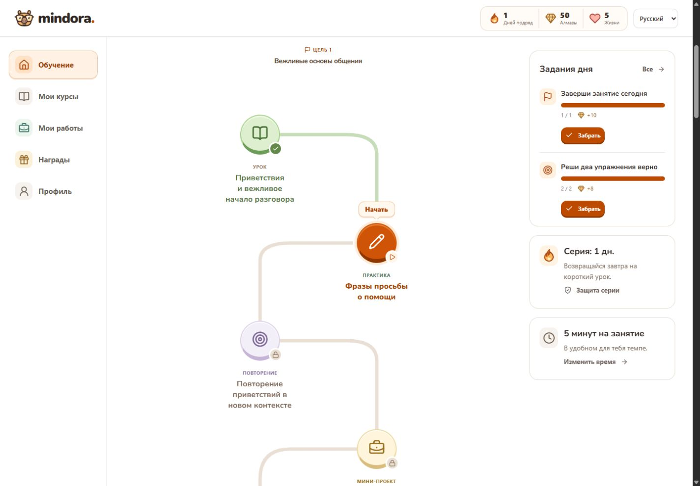
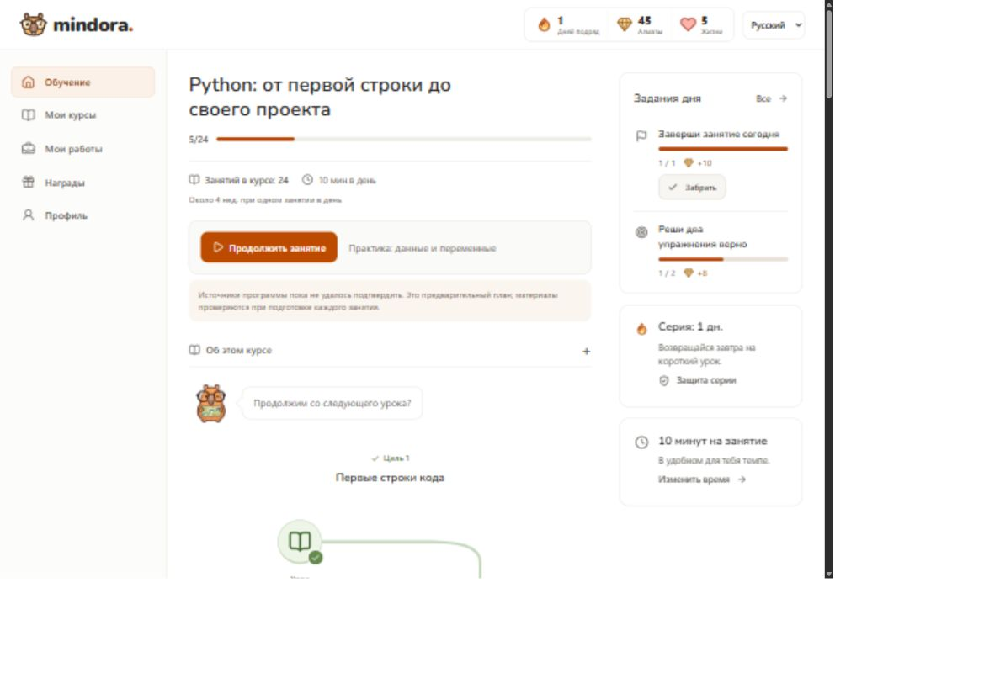
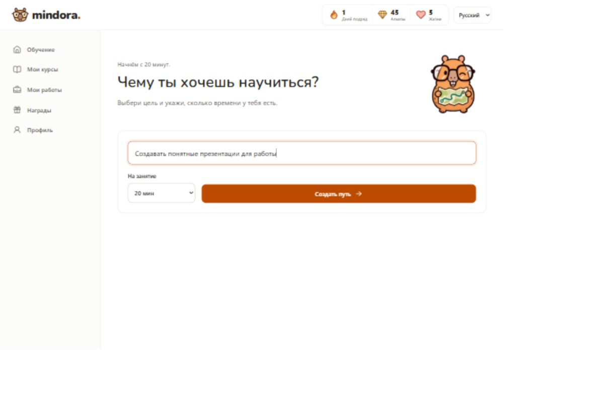

# Desktop design polish

Branch: `design/unslop-polish`. Base: `5cb0fbc`.

## Direction

A calm learning workspace for short daily lessons. Keep Mindora's orange, Nunito and Mino. Give the active lesson visual priority, tighten the desktop path and make saved courses easier to scan. The initial audit found oversized bold headings, repeated prominent actions and excessive space between path nodes.

## Scope

The only runtime change is appended desktop CSS in `ui/desktop-study.css`, scoped to widths of at least 921px. Navigation, goal composer, saved courses, course path, side cards and profile get more consistent spacing, type and borders. The continuous path and all four node types remain. Existing mobile rules, markup, IDs, data attributes, event handlers, API calls and persistence are unchanged.

## Evidence

- `npm run check`: passed.
- `npm test`: 398 passed, zero failures.
- `node scripts/build.mjs`: passed.
- `git diff --check`: passed.
- Browser checks used the actual app with an in-memory fixture API, not live AI or production account data.
- Opened a saved course, its path and a lesson; completed a Python answer and saw the correct-answer feedback; returned to the path.
- Opened the profile and goal composer; entered a goal and selected 20 minutes; both survived a resize; the create action opened clarification.
- No horizontal overflow at observed CSS viewport widths of 1187px, 954px, 325px and 312px. Mobile remains on the original design.
- Independent CSS review confirmed focus states, reduced motion and disabled controls are preserved.

## Screenshots

The before image is from production and uses a different course/language; it illustrates the original styling, not an identical-content comparison. After images use synthetic fixture data.

## Attribution

Workflow based on [Unslop](https://github.com/heydamir/unslop) by Damir Sokolovsky, [CC BY 4.0](https://creativecommons.org/licenses/by/4.0/). Adapted to Mindora's existing brand and desktop-only scope.
